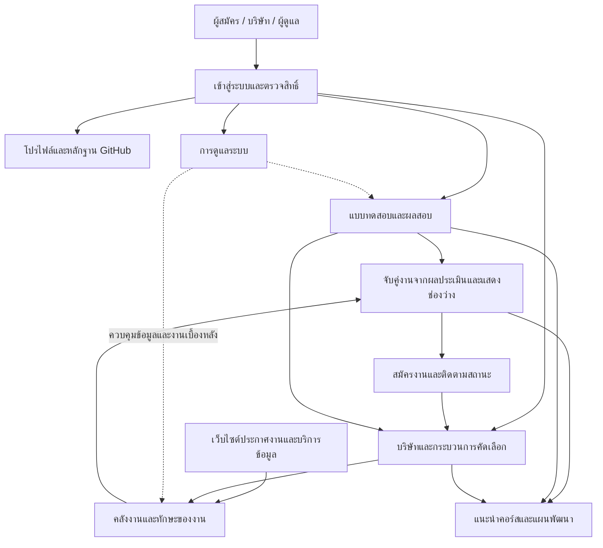
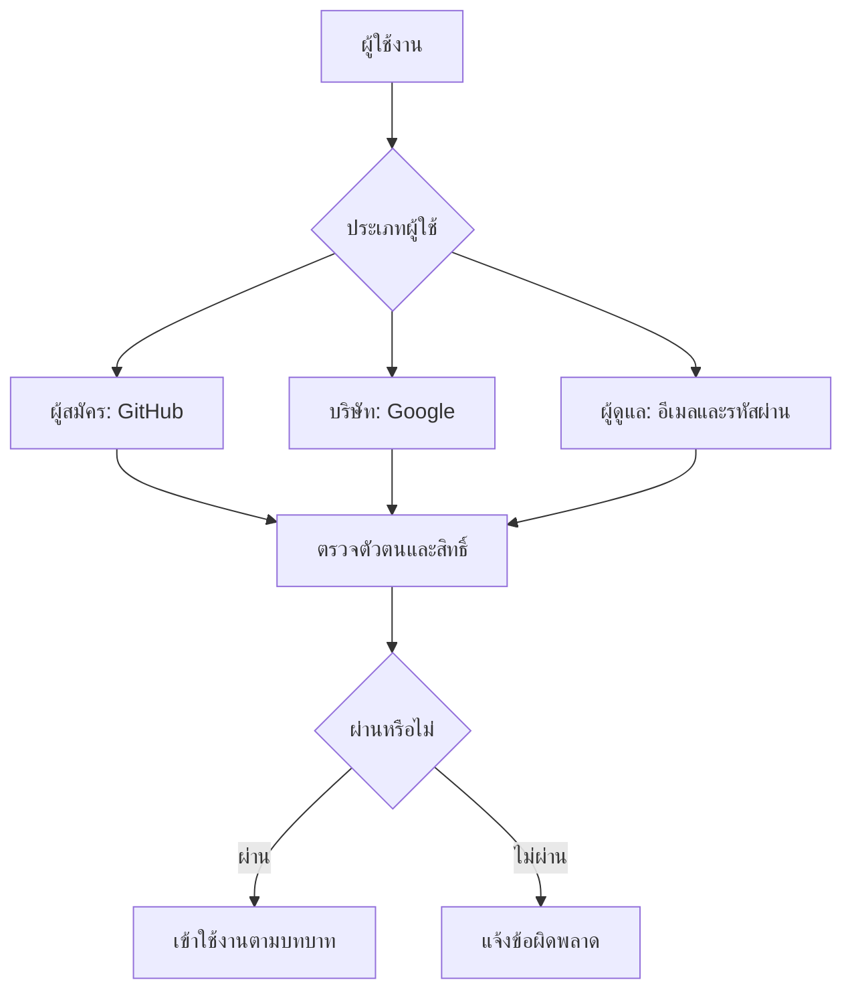
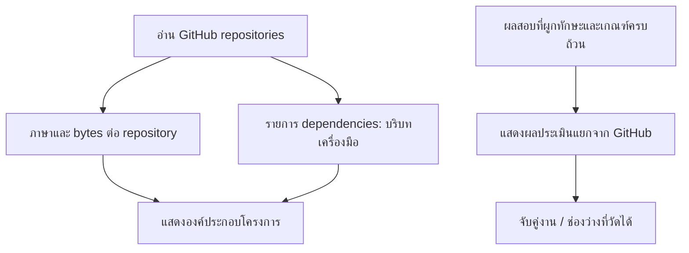
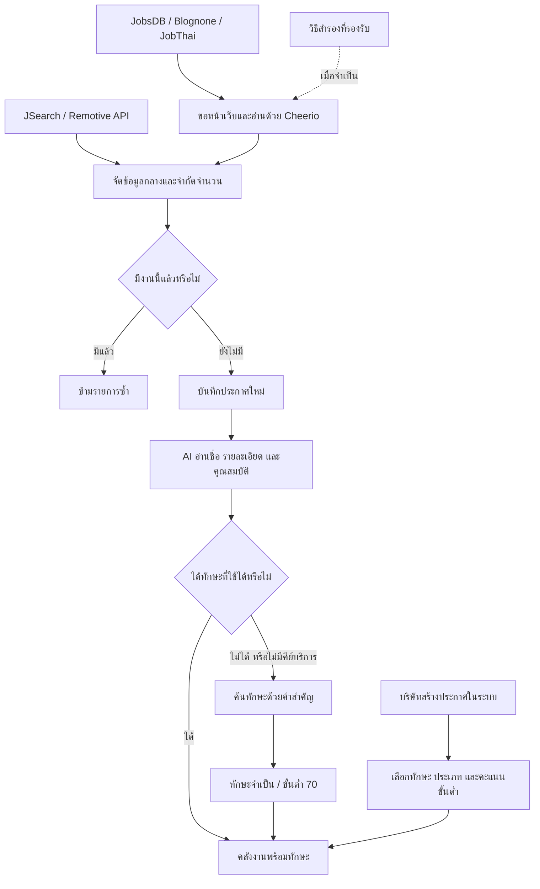
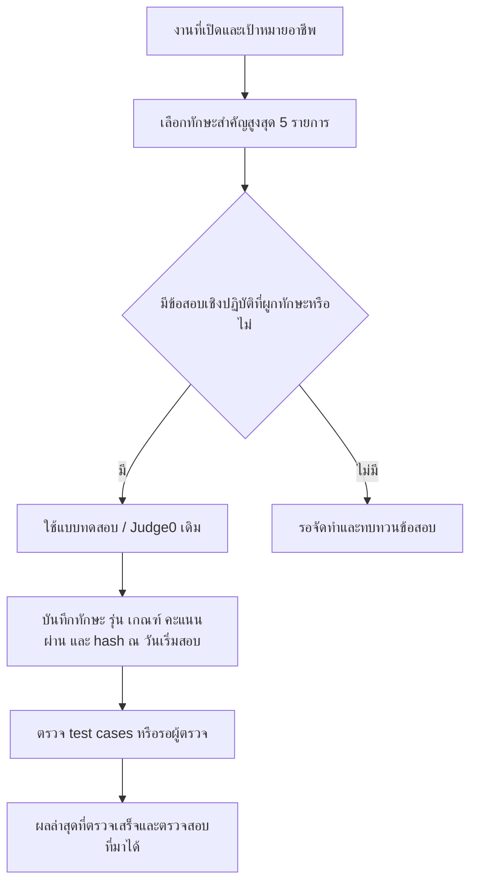
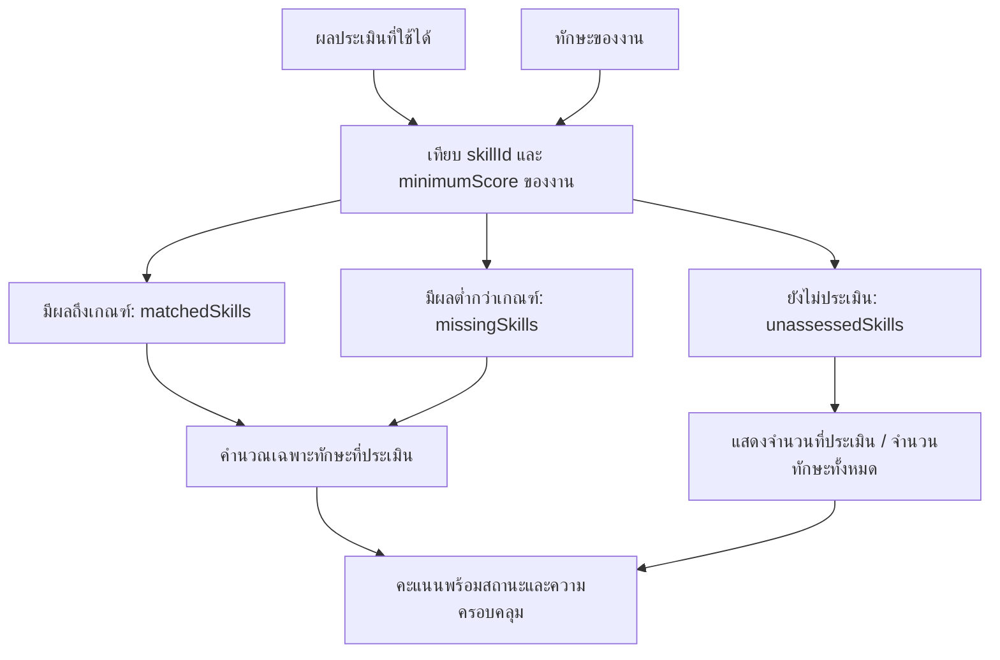
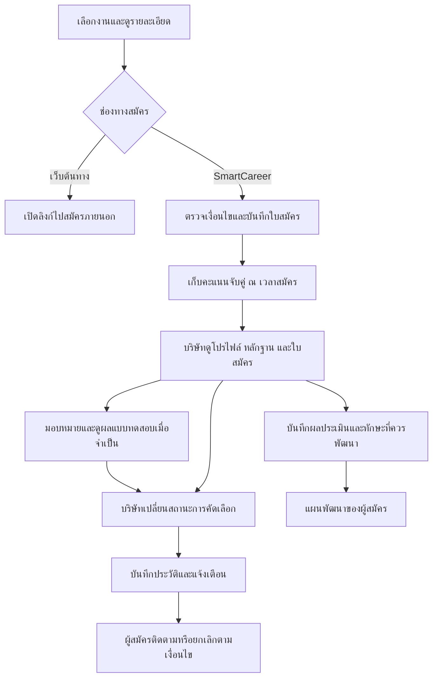
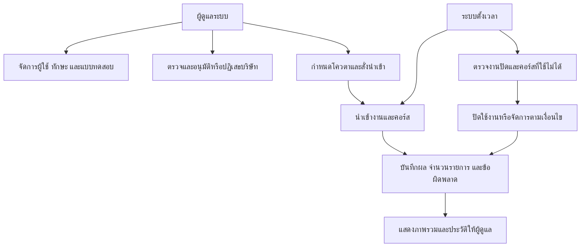
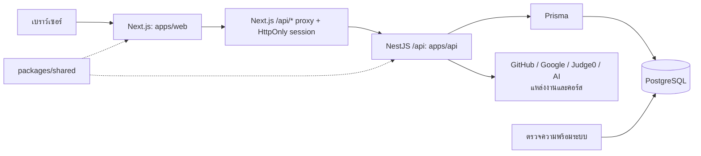

# SmartCareer — ระบบวิเคราะห์ทักษะและจับคู่งาน

SmartCareer รวบรวมประกาศงาน แสดงบริบทโครงการ GitHub และใช้ผลประเมินทักษะเปรียบเทียบกับความต้องการของงาน และแนะนำคอร์สเพื่อพัฒนาทักษะ ผู้สมัครสามารถทำแบบทดสอบและสมัครงาน ส่วนบริษัทสามารถประกาศงาน คัดเลือกผู้สมัคร และให้ข้อเสนอแนะได้

เอกสารนี้สรุปการทำงานและแผนภาพ Mermaid จากโค้ดใน workspace ณ วันที่ 27 ตุลาคม 2569 เป็นคำอธิบายความสามารถที่พบในโค้ด ไม่ใช่การรับรองว่าทุกบริการภายนอกพร้อมใช้งานหรือทุกกรณีผ่านการทดสอบแล้ว

## สารบัญ

- [ภาพรวมระบบ](#overview)
- [ผู้ใช้งานและสิทธิ์](#access)
- [โปรไฟล์และหลักฐานทักษะ](#profile)
- [ประกาศงานและการวิเคราะห์ทักษะ](#ingestion)
- [แบบทดสอบและผลประเมิน](#assessment)
- [การจับคู่งานและสูตรคะแนน](#matching)
- [การสมัครงานและคัดเลือก](#recruitment)
- [คำแนะนำคอร์สและแผนพัฒนา](#learning)
- [ผู้ดูแลและงานเบื้องหลัง](#administration)
- [สถาปัตยกรรมและไฟล์สำคัญ](#architecture)
- [การติดตั้งและใช้งาน](#setup)
- [การทดสอบและ CI](#verification)
- [สถานะ production และเอกสารอ้างอิง](#production)

<a id="overview"></a>

## 1. ภาพรวมระบบ



ภาพรวมเชื่อมกระบวนการหลัก ส่วนแผนภาพย่อยด้านล่างอธิบายรายละเอียดทีละส่วน ลูกศรเส้นประแสดงการควบคุมหรือสนับสนุน

<a id="access"></a>

## 2. ผู้ใช้งานและสิทธิ์

| บทบาท | ความสามารถหลัก |
|---|---|
| ผู้เยี่ยมชม | ค้นหางาน ดูคอร์ส และทดลองวิเคราะห์ GitHub สาธารณะ |
| ผู้สมัคร | จัดการโปรไฟล์ วิเคราะห์ GitHub ทำแบบทดสอบ สมัครงาน และติดตามแผนพัฒนา |
| บริษัท | จัดการข้อมูลบริษัท ประกาศงาน สร้างข้อสอบ ดูผู้สมัคร และบันทึกผลประเมิน |
| ผู้ดูแล | จัดการผู้ใช้ ทักษะ แบบทดสอบ ตรวจบริษัท และควบคุมการนำเข้าข้อมูล |



<a id="profile"></a>

## 3. โปรไฟล์และบริบทโครงการ GitHub

จำนวนรวมบนโปรไฟล์ใช้ป้าย “ทักษะที่บันทึกไว้” ซึ่งรวมรายการที่ยังไม่ประเมิน ไม่ใช่จำนวนทักษะที่สอบผ่าน

GitHub/Linguist บอกภาษาและจำนวน bytes ในแต่ละ repository ส่วน dependencies/devDependencies เป็นเบาะแสเครื่องมือที่โครงการอ้างถึง ข้อมูลเหล่านี้ไม่ยืนยันว่าใครเขียนโค้ดหรือชำนาญเพียงใด แม้พบภาษาเพียงเล็กน้อยก็ไม่สร้างคะแนนทักษะ



เปอร์เซ็นต์ภาษา = bytes ของภาษานั้น / bytes รวมที่ GitHub รายงานใน repository เดียวกัน × 100 เป็น **สัดส่วนโค้ดใน repository ไม่ใช่เปอร์เซ็นต์ความชำนาญของผู้สมัคร** ระบบไม่ใช้ชื่อโครงการ คำอธิบาย topics ขนาด ดาว หรือจำนวน repository เป็นคะแนน

ยกเลิก `githubEvidenceScore` และสูตรฐาน 60 + น้ำหนัก 20/25 แล้ว GitHub sync ไม่แก้คะแนนทักษะ และเขียน `scoreContribution=0` ในหลักฐานใหม่เพื่อรองรับคอลัมน์เดิม ค่าประวัติในฐานข้อมูลยังอยู่ แต่ไม่มีผลต่อ matching/recommendations API โปรไฟล์คืน `practicalScore/verifiedScore=null` พร้อม `hasGithubEvidence`, `assessmentScore`, `assessmentStatus` และที่มาผลประเมิน

กราฟโปรไฟล์เฉลี่ยเฉพาะผลทักษะที่ประเมินแล้วในแต่ละหมวด หมวดที่ยังไม่มีผลคืน `null` และไม่วาดแทนด้วย 0 คะแนนจริง 0 จากการสอบยังแสดงได้ ไม่ใช่การประเมินครบทุกทักษะในหมวด


<a id="ingestion"></a>

## 4. ประกาศงานและการวิเคราะห์ทักษะ

### เครื่องมือและข้อมูลที่ได้รับ

| เครื่องมือหรือช่องทาง | หน้าที่ |
|---|---|
| Axios | ขอเนื้อหาหน้าเว็บหรือข้อมูลจากบริการ |
| Cheerio | อ่านส่วนต่าง ๆ ของหน้าเว็บตามรูปแบบที่กำหนด แล้วหยิบชื่อ บริษัท รายละเอียด และลิงก์ |
| Puppeteer / HTTP/2 | ทางสำรองเมื่อการอ่าน JobsDB หรือ Blognone เข้าเงื่อนไขที่กำหนด |
| JSearch / Remotive API | รับข้อมูลที่บริการจัดเตรียมไว้โดยตรง |
| ระบบหลังบ้านและ Prisma | จัดข้อมูลลงช่องกลาง ตรวจซ้ำ และบันทึกลงฐานข้อมูล |

JobsDB ให้ชื่อ บริษัท รายละเอียดสั้น สถานที่ และลิงก์; Blognone อาจมีประเภทงานและเงินเดือนที่แสดงบนหน้า; JobThai ในรอบปกติให้ข้อมูลหลัก เช่น ชื่อ บริษัท และลิงก์ ข้อมูลบางช่องอาจว่างหรือเป็นค่าเริ่มต้น จึงไม่ควรถือว่าทุกช่องได้รับการยืนยันจากต้นทาง การอ่านหน้ารายละเอียดเพิ่มเติมเป็นอีกขั้นตอนหนึ่ง



การจัดข้อมูลและตรวจงานซ้ำไม่ใช้ AI ระบบตรวจซ้ำจากแหล่งที่มาและรหัสประกาศ หรือจากชื่อตำแหน่งกับบริษัท งานที่ซ้ำถูกข้ามก่อนวิเคราะห์ทักษะ

### AI และข้อความสั่งงาน

รายชื่อที่โค้ดลองตามลำดับคือ `gemma-4-26b-a4b-it`, `gemini-3.6-flash`, `gemini-3.8-flash` และ `gemini-flash-latest` รายชื่อนี้เป็นการตั้งค่าในโค้ด ไม่ยืนยันว่าทุกรุ่นเรียกใช้สำเร็จ ไม่มีบันทึกเหตุผลว่าเหตุใดเลือก Gemma เป็นตัวแรก และคอมเมนต์บางจุดที่ระบุ Gemini 1.5 Flash เป็นข้อความเก่า

Prompt กำหนดให้ AI อ่านประกาศในบทบาทผู้สรรหาสายเทค ดึงเฉพาะเทคโนโลยีที่ระบุไว้ ห้ามเดาจากตำแหน่งหรือบริษัท แล้วส่งชื่อทักษะ หมวดหมู่ ความจำเป็น และคะแนนขั้นต่ำในรูปแบบ JSON เหตุผลเชิงออกแบบคือทำให้ข้อมูลประกาศหลายรูปแบบเชื่อมกับคลังทักษะเดียวกันได้ คำสั่งเต็มอยู่ใน [gemini-extractor.service.ts](apps/api/src/ingestion/gemini-extractor.service.ts)

หลังรับผล ระบบตรวจชื่อทักษะกับข้อความและผลจากกฎคำสำคัญอีกครั้ง คะแนนขั้นต่ำจาก AI เป็นค่าประเมิน ไม่ใช่คะแนนที่นายจ้างต้นทางยืนยันโดยตรง

### คำสำคัญสำหรับวิธีสำรอง

ระบบค้นจากชื่อตำแหน่ง รายละเอียด และคุณสมบัติ โดยไม่แยกตัวพิมพ์เล็ก–ใหญ่

| หมวด | ทักษะที่รองรับ |
|---|---|
| ส่วนหน้าเว็บไซต์ | React, Next.js, JavaScript, TypeScript, HTML5, CSS3, Tailwind CSS, Bootstrap, Angular, Vue.js, Redux, RxJS, Adobe XD, Figma |
| ส่วนหลังและ API | Node.js, NestJS, REST APIs, GraphQL, Python, Java, Spring Boot, Go, C#, PHP |
| ฐานข้อมูล | PostgreSQL, MySQL, MongoDB, Redis, SQL |
| ระบบและ DevOps | Docker, Kubernetes, AWS, Git, CI/CD, Linux, OpenShift, Tomcat |
| การทดสอบ | Postman, Selenium, Playwright, Cypress, Jest, Automated Testing, Manual Testing |
| มือถือ | Flutter, React Native |

มีคำพ้องที่กำหนดไว้ เช่น `reactjs` เป็น React, `k8s` เป็น Kubernetes และ `postgres` เป็น PostgreSQL กฎปัจจุบันต้องพบชื่อ Redis/SQL อย่างชัดเจน ไม่แปลงคำทั่วไป `cache` หรือ `database` เป็นสองทักษะนี้ รายการในตารางเป็นตัวอย่าง ไม่ใช่รายการทั้งหมด โค้ดยังรองรับทักษะขาย ประสานงาน การเขียน ระบบเครือข่าย และเครื่องมืออุตสาหกรรม โดยวิธีสำรองใช้ค่าของแต่ละกฎถ้ามี มิฉะนั้นกำหนดเป็นทักษะจำเป็นและขั้นต่ำ 70

<a id="assessment"></a>

## 5. แบบทดสอบและผลประเมิน

ใช้ระบบ Assessment/Question/Attempt และ Judge0 เดิม ไม่สร้างข้อสอบให้ทุกภาษาที่ GitHub พบ แผนประเมินคัดสูงสุด 5 ทักษะจากประกาศงานที่เปิด ไม่หมดอายุ และตรงเป้าหมายอาชีพ เรียงตามจำนวนงานที่กำหนดเป็นทักษะจำเป็น ตามด้วยจำนวนงานทั้งหมดที่พบทักษะ หากไม่มีงานตรงเป้าหมายจะไม่ใช้เกณฑ์ Full Stack แทนโดยเงียบ ๆ



ผลที่ใช้เป็นคะแนนทักษะต้องเป็นรอบ `COMPLETED` ของข้อสอบแพลตฟอร์ม `PRACTICAL_CODING` มี snapshot รุ่นนโยบาย 1 ระบุทักษะและเกณฑ์ชัดเจน ใช้ automated test cases ครบ หรือผ่าน human review สำหรับข้อแบบ open-ended ผล AI ที่ยังไม่ผ่านผู้ตรวจไม่ใช้คำนวณทักษะ คะแนนทฤษฎีและผลบริษัทคงอยู่ในประวัติ/การคัดเลือกตามสิทธิ์ ไม่แปลงเป็นคะแนนเชิงปฏิบัติส่วนกลาง

เลือกผลล่าสุดที่เข้าเงื่อนไขต่อทักษะ ไม่ใช้คะแนนดีที่สุดใน cache รอบใหม่ที่กำลังทำหรือรอตรวจไม่ลบผลก่อนหน้าที่ใช้ได้ ส่วน expired/system error/ไม่มี snapshot ที่ผูกทักษะได้ไม่ถือเป็นผลวัดระดับ ผู้สมัครยังอ่านประวัติเดิมได้ เกณฑ์หรือโจทย์เปลี่ยนกลางรอบจะถูกตรวจด้วย hash และไม่ตรวจด้วยเกณฑ์ที่ผิดจากวันเริ่มสอบ

การขยายชุด JavaScript เดิมจาก 1 เป็น 2 ข้อใช้ migration แบบระบุขอบเขตและ hash: เก็บโจทย์/เกณฑ์รุ่น 1 ใน `assessment_bank_revisions` ที่จำกัดสิทธิ์ ฝั่งผู้ตรวจอ่านเกณฑ์รุ่นเดิม ส่วนผู้สมัครเห็นรุ่น จำนวนข้อ และคะแนนเต็มเดิมโดยไม่เห็นเฉลย ผล 50/50 ของชุดเก่าจึงยังเป็น 100% ไม่ถูกหารด้วย 100 ของชุดใหม่ ไม่เขียนทับผลสอบ/คำตอบ/snapshot เดิม และไม่เติมหลักฐานทักษะย้อนหลังให้ผลเก่า รายละเอียดอยู่ใน [รายงาน staging](docs/ASSESSMENT_EXPANSION_STAGING.md)

สถานะรายทักษะคือ `ASSESSED` (มีผลประเมินถึงเกณฑ์), `GAP` (พบช่องว่างจากผลประเมิน) และ `NOT_ASSESSED` (ยังไม่มีผลที่ใช้ได้) เกณฑ์ในโปรไฟล์เป็นคะแนนผ่านข้อสอบ ส่วน matching เทียบเกณฑ์ของงาน จึงต้องอ่านเกณฑ์ประกอบทุกครั้ง

ข้อสอบและเกณฑ์ระบุ **รอผู้เชี่ยวชาญตรวจและทดลองใช้** การมี test cases ไม่ใช่หลักฐานยืนยันคุณภาพข้อสอบ รายละเอียดข้อจำกัดของชุดเดิมอยู่ใน [รายงานการปรับระบบ](docs/ASSESSMENT_POLICY_IMPLEMENTATION.md)

ชุด JavaScript รุ่น 3 เป็นฉบับร่างที่ผ่านการทดสอบ staging และ deploy production ผ่าน PR #4 แล้ว: ตรวจชนิดค่าคืนและ Unicode ตามโจทย์ เพิ่ม cases เป็น 10 + 12 กรณี และใช้ `CRITERION_GATE_V1` ให้คะแนนตามองค์ประกอบที่ผ่านทุกกรณี หากองค์ประกอบจำเป็นไม่ผ่าน คะแนนข้อนั้นไม่เกิน 15/50 เพื่อไม่ให้คะแนนเต็มอีกข้อชดเชยจนผ่าน 70 เกณฑ์นี้ยังไม่ได้ calibration กับมนุษย์ ชุดเก่าที่ไม่ใช้ rubric รุ่นนี้ยังคงสูตรเดิม ดู [รายละเอียดและผล staging รุ่น 3](docs/ASSESSMENT_V3_STAGING.md)


<a id="matching"></a>

## 6. การจับคู่งานและสูตรคะแนน

ใช้ผลประเมินจริงที่ผูก `skillId` เท่านั้น ไม่ใช้ GitHub หรือ cache คะแนนเดิม รวมถึงไม่ให้คะแนนจากคำในชื่ออาชีพ



แต่ละทักษะที่ประเมินได้เครดิต `min(1, ผลสอบ / minimumScore) × 100` คำนวณ R และ P เป็นค่าเฉลี่ยเฉพาะทักษะที่มีผลในกลุ่มจำเป็น/เสริม แล้วใช้ `M=(0.7R+0.2P)/น้ำหนักรวมของกลุ่มที่มีผล` กลุ่มที่ไม่มีผลไม่นับในตัวหารและไม่ให้ 100 คะแนนโดยอัตโนมัติ น้ำหนักนี้เป็นนโยบายต้นแบบที่ยังต้องสอบเทียบกับผู้เชี่ยวชาญ

- `assessmentCoverage = assessedCount / totalSkills × 100` แสดงเสมอพร้อมคะแนน
- มีผลบางทักษะ: `status=PRELIMINARY` พร้อมข้อความ **คะแนนเบื้องต้น**
- ไม่มีผลที่ใช้ได้ หรืองานไม่มีรายการทักษะ: `matchScore=null`, `status=AWAITING_ASSESSMENT`
- มีผลครบ: `status=ASSESSED` หมายถึงมีข้อมูลครบตามรายการ ไม่ได้แปลว่าผ่านทุกทักษะ
- ทักษะที่ยังไม่ประเมินใช้ `userScore=null` อยู่ใน `unassessedSkills` ไม่อยู่ในช่องว่าง และไม่มีคะแนน 0/100 แฝง
- เกณฑ์งานไม่เป็นตัวเลขในช่วงมากกว่า 0 ถึง 100: ไม่คิดคะแนนทักษะนั้น พร้อมเหตุผล `INVALID_JOB_CRITERION`

ตัวอย่างงานมี 2 ทักษะ สอบหนึ่งทักษะได้ 80 เทียบเกณฑ์ 80: คะแนน 100% **เบื้องต้น**, ประเมิน 1/2 (50%) ไม่ได้แปลว่าผ่านทั้งงาน หากสอบทักษะที่สองได้ 40 เทียบ 80 และทั้งคู่เป็นทักษะจำเป็น จะได้คะแนน 75% จากผลครบ 2/2

หน้ารายการและรายละเอียดใช้สูตรเดียวกัน ใบสมัครใหม่เก็บคะแนนที่เป็น null ได้ และ `matchAssessmentSnapshot` รวม policyVersion, coverage, สถานะ และ attemptId ใบสมัครเก่าที่ไม่มี snapshot เก็บตัวเลขเดิมไว้ในฐานข้อมูลเพื่อ audit แต่ API/UI/CSV ไม่แสดงเป็นคะแนนจากการประเมินใหม่


<a id="recruitment"></a>

## 7. การสมัครงานและคัดเลือก



สถานะประกอบด้วย APPLIED, REVIEWING, INTERVIEW, TECHNICAL_TEST, OFFER, ACCEPTED, REJECTED และ CANCELLED การเปลี่ยนสถานะขึ้นกับเงื่อนไขของระบบ ไม่จำเป็นต้องผ่านทุกขั้น ใบสมัครเก็บประวัติและรอบการสมัครเพื่อรักษาข้อมูลเดิม บริษัทประเมินด้านเทคนิค การแก้ปัญหา การสื่อสาร และการทำงานเป็นทีมได้

หน้ารายการผู้สมัครและฟอร์มผลประเมินใช้ข้อสอบที่มอบหมายเฉพาะผู้สมัครก่อนข้อสอบตั้งต้นของงาน และเลือกผลรอบล่าสุดของข้อสอบนั้นพร้อมเกณฑ์ผ่านของข้อสอบเดียวกัน หากยังไม่ทำจะแสดงว่ายังไม่ได้สอบ หากรอตรวจจะไม่แสดงว่าผ่านหรือไม่ผ่าน ผลสอบต่างข้อสอบไม่ถูกนำมาแทนกัน

<a id="learning"></a>

## 8. คำแนะนำคอร์สและแผนพัฒนา

คอร์สแนะนำตัดลิงก์ปลายทางซ้ำก่อนจำกัดจำนวน และต้องมีข้อความชื่อทักษะหรือ alias รองรับในชื่อ/คำอธิบาย โดยจัดชื่อคอร์สที่ตรงทักษะไว้ก่อน ใช้กติกาเดียวกันกับหน้ารายละเอียดงานและแผนพัฒนาบริษัท ดู [รายละเอียดการคัดคอร์ส](docs/COURSE_RECOMMENDATION_CLEANUP.md)

คำแนะนำส่วนบุคคลใช้เฉพาะช่องว่างจากผลประเมินที่วัดได้ ไม่มีการแปลง GitHub เป็นคะแนนหรือกำหนดคะแนนทักษะที่ยังไม่สอบเป็น 0

1. **งานที่เลือก:** ค้นคอร์สเฉพาะ `missingSkills` ซึ่งมีผลสอบต่ำกว่าเกณฑ์งาน หากยังไม่ประเมินให้ไปเลือกข้อสอบ หากไม่มีช่องว่างจะไม่สร้างคำแนะนำเฉพาะบุคคลจากทักษะทั้งหมดของงาน
2. **เป้าหมายอาชีพ:** เลือกทักษะสำคัญจากงานที่เปิดและตรงเป้าหมาย เกณฑ์รายทักษะเป็นค่าสูงสุดที่งานกลุ่มนั้นระบุ แสดง jobIds/จำนวนงานที่ใช้เป็นที่มา เปรียบเทียบกับผลประเมินล่าสุดเฉพาะทักษะที่มีผล แล้วแนะนำสูงสุด 3 คอร์สต่อช่องว่าง
3. **ยังไม่ประเมิน:** แสดง `assessmentPlan/unassessedSkills`, คะแนน null และข้อสอบเดิมที่พร้อมให้ทำ หากไม่มีข้อสอบให้ระบุว่ารอจัดทำ/ทบทวน ไม่แต่งข้อสอบหรือคะแนนแทน
4. **ข้อเสนอแนะจากบริษัท:** คงแผนพัฒนาที่บริษัทระบุทักษะไว้อย่างชัดเจน แยกจากช่องว่างเชิงตัวเลข ผู้สมัครบันทึกความคืบหน้า หมายเหตุ และลิงก์ผลงานได้

รายการคอร์สทั่วไปยังค้นหาได้ แต่ไม่ถือเป็นคำแนะนำจากช่องว่างส่วนบุคคล การไม่พบช่องว่างไม่ได้ยืนยันว่ามีทักษะครบ ต้องอ่านสถานะยังไม่ประเมินประกอบ เกณฑ์งานที่สกัดโดย AI/กฎและวิธีเลือกค่าสูงสุดยังต้องให้เจ้าของระบบ/ผู้เชี่ยวชาญสอบเทียบ


<a id="administration"></a>

## 9. ผู้ดูแลและงานเบื้องหลัง



เมื่อเปิด scheduler (ตั้ง `ENABLE_SCHEDULED_JOBS=false` ก่อนเริ่ม API เพื่อปิดงานตามเวลา): ตารางตามเวลา Asia/Bangkok: 00:00 นำเข้างานและคอร์ส, 00:30 ตรวจงานปิด, 00:35 ตรวจคอร์สที่ใช้ไม่ได้ งานที่ปิดถูกปิดใช้งานเพื่อรักษาใบสมัครและประวัติ ส่วนการจัดการคอร์สขึ้นกับเงื่อนไขของตัวตรวจ

<a id="architecture"></a>

## 10. สถาปัตยกรรมและไฟล์สำคัญ



โครงการเป็น npm workspaces มี 3 packages: `@smartcareer/web`, `@smartcareer/api` และ `@smartcareer/shared` เว็บใช้ Next.js 15 / React 19, API ใช้ NestJS 10 และ Prisma 5; Node.js 22 เป็นรุ่นที่ใช้ใน CI และ Docker

```text
.
├── apps/
│   ├── api/
│   │   ├── src/
│   │   │   ├── main.ts / app.module.ts
│   │   │   ├── auth/ candidate/ company/ admin/
│   │   │   ├── github/ skills/ assessments/ matching/
│   │   │   ├── jobs/ applications/ evaluations/ recommendations/
│   │   │   └── ingestion/ scheduler/ notifications/ health/ prisma/
│   │   └── config/                 # ค่าการนำเข้าที่บันทึกไว้
│   └── web/
│       ├── app/                    # Next.js App Router
│       │   ├── (auth)/ auth/        # login/register และ OAuth callback
│       │   ├── profile/ jobs/ assessments/ courses/
│       │   ├── applications/ learning-plan/
│       │   ├── company/ admin/
│       │   └── api/[...path]/route.ts
│       ├── components/             # UI ที่ใช้ร่วมกัน
│       ├── lib/                    # API client, auth และ helper
│       └── public/
├── packages/shared/src/            # ชนิดข้อมูล กติกาผลสอบ และสูตรจับคู่
├── prisma/
│   ├── schema.prisma
│   ├── migrations/                 # incremental SQL; ไม่มี initial baseline
│   ├── assessment-bank/            # โจทย์ เกณฑ์ test cases และเฉลยฝั่ง server
│   └── seed*.ts                    # ตรวจขอบเขตก่อนรัน
├── scripts/                        # release, integration และ maintenance
├── tests/                          # node:test ใช้ compiled API/shared
├── docs/                           # นโยบาย rollout และรายงานทดสอบ
├── .github/workflows/verify.yml
├── Dockerfile.api / Dockerfile.web
├── docker-compose.prod.yml / Caddyfile
└── package.json / package-lock.json
```

`dist/`, `.next/`, `node_modules/` และ `output/` เป็นผล build, dependencies หรือหลักฐานการรัน ไม่ใช่โมดูลระบบหลัก

### โมดูลและเส้นทางหลัก

ทุก controller ของ NestJS ใช้ prefix `/api` จาก `main.ts` ตารางนี้สรุปกลุ่มเส้นทาง ไม่ใช่สัญญา request/response ครบทุก endpoint; ตรวจ method และ guards ใน controller ของโมดูลก่อนเรียกใช้

| โมดูลใน `apps/api/src` | กลุ่ม API | หน้าที่ |
|---|---|---|
| `auth` | `/api/auth/*` | OAuth, session exchange, JWT และสิทธิ์บทบาท |
| `candidate`, `github`, `skills` | `/api/candidate/*`, `/api/github/*`, `/api/skills/*` | โปรไฟล์ บริบท repositories และคลังทักษะ |
| `assessments` | `/api/assessments/*` | เริ่มสอบ รันโค้ด ส่งคำตอบ ตรวจผล และประวัติ |
| `jobs`, `matching` | `/api/jobs/*` | รายการ/รายละเอียดงานและคะแนนจับคู่; matching เป็น service ไม่มี controller แยก |
| `applications`, `evaluations` | `/api/applications/*`, `/api/evaluations/*` | ใบสมัครและผลประเมินบริษัท |
| `company`, `admin` | `/api/company/*`, `/api/admin/*` | งานบริษัทและการดูแลระบบตามสิทธิ์ |
| `recommendations` | `/api/recommendations/*` | skill-gaps, courses และ development-plan |
| `ingestion`, `scheduler` | `/api/ingestion/*` | นำเข้าข้อมูลและงานตามเวลา; scheduler ไม่มี controller แยก |
| `notifications`, `health` | `/api/notifications/*`, `/api/health`, `/api/health/ready` | การแจ้งเตือนและตรวจการเชื่อมต่อฐานข้อมูล |
| `prisma` | ไม่มี public endpoint | PrismaService สำหรับเข้าฐานข้อมูล |

### การเรียก API และ session

[API client ของเว็บ](apps/web/lib/api.ts) เรียก same-origin `/api/*` ผ่าน [Next.js proxy](apps/web/app/api/[...path]/route.ts) โดย session อยู่ใน cookie `smartcareer_session` แบบ HttpOnly; proxy ส่ง JWT ไป backend และตรวจ Origin ของคำขอที่แก้ข้อมูล ระบบมีทางย้าย token เก่าจาก localStorage แล้วลบค่าเดิม ไม่ใช้ localStorage เป็นที่เก็บ session ใหม่

proxy เลือก backend จาก `API_URL` ก่อน `NEXT_PUBLIC_API_URL` แล้วจึงใช้ค่า fallback ตาม environment ส่วน OAuth มี callback เข้า NestJS และกลับเว็บเพื่อแลก session จึงต้องตั้ง callback และ frontend origin ให้สอดคล้องกัน

### ไฟล์ logic ที่ควรเริ่มอ่าน

| ไฟล์ | หน้าที่ |
|---|---|
| [skill-assessment.ts](packages/shared/src/skill-assessment.ts) | เลือกผลทักษะที่ใช้ได้ คะแนนจับคู่ และ coverage |
| [candidate-screening.ts](packages/shared/src/candidate-screening.ts) | การเลือกผลสอบสำหรับการคัดกรอง |
| [assessments.service.ts](apps/api/src/assessments/assessments.service.ts) | lifecycle ของรอบสอบและ snapshot |
| [judge0.client.ts](apps/api/src/assessments/judge0.client.ts) | รันโค้ดผ่าน Judge0 |
| [automated-rubric.ts](apps/api/src/assessments/automated-rubric.ts) | criterion gate และเพดานคะแนนองค์ประกอบจำเป็น |
| [course-selection.ts](apps/api/src/recommendations/course-selection.ts) | ตัวตน URL, ตัดคอร์สซ้ำ และจัดลำดับความเกี่ยวข้อง |
| [recommendations.service.ts](apps/api/src/recommendations/recommendations.service.ts) | ช่องว่างจากงาน/อาชีพและแผนพัฒนาบริษัท |
| [ingestion.service.ts](apps/api/src/ingestion/ingestion.service.ts) | นำเข้าประกาศงานและคอร์ส |
| [gemini-extractor.service.ts](apps/api/src/ingestion/gemini-extractor.service.ts) | Prompt และกฎค้นทักษะ |
| [scheduler.service.ts](apps/api/src/scheduler/scheduler.service.ts) | ตารางงานนำเข้าและตรวจข้อมูลหมดอายุ |
| [schema.prisma](prisma/schema.prisma) | แบบจำลองข้อมูล |

<a id="setup"></a>

## 11. การติดตั้งและใช้งาน

### ช่องทางสมัครและเข้าสู่ระบบ

| บทบาท | สมัครสมาชิก | เข้าสู่ระบบ | หน้าหลัก |
|---|---|---|---|
| Candidate | GitHub เท่านั้น | GitHub เท่านั้น | `/profile` |
| Company | Google เท่านั้น | Google เท่านั้น | `/company/dashboard` |
| Admin | สร้างโดยผู้ดูแลระบบเท่านั้น | อีเมลและรหัสผ่าน | `/admin/dashboard` |

บัญชีเดิมยังเก็บข้อมูลทั้งหมดไว้ การเชื่อมบัญชีเดิมต้องใช้อีเมลที่ผู้ให้บริการยืนยันตรงกับบัญชีเดิม และชื่อ GitHub ที่ผูกไว้ต้องตรงกัน ไม่รองรับรหัสผ่านของผู้สมัครหรือบริษัทอีกต่อไป

การตรวจอัตโนมัติใช้ตัวจำลองผู้ให้บริการเฉพาะฐานข้อมูลแยกในเครื่อง (`ENABLE_DEV_MOCK_AUTH=true` และ `NODE_ENV=development`) ตัวจำลองปิดใน production เสมอ และไม่ใช้แทนการตรวจ GitHub/Google จริง

ดูขั้นตอนทดสอบนโยบายใหม่ที่ [OAuth-only UAT](docs/uat/AUTH_PROVIDER_POLICY.md)

---

### รันในเครื่อง

#### เตรียมเครื่องครั้งแรก

ใช้ Node.js 22 และ PostgreSQL ที่เปิดใช้งานแล้ว คัดลอก `.env.example` เป็น `.env` ที่โฟลเดอร์หลักหากยังไม่มี แล้วตั้ง `DATABASE_URL` ให้ตรงกับฐานข้อมูลทดสอบของเครื่อง และกำหนด `JWT_SECRET` แบบสุ่มอย่างน้อย 32 ตัวอักษร ตั้ง `ENABLE_SCHEDULED_JOBS=false` หากไม่ต้องการให้งานนำเข้า/cleanup ทำงานระหว่างพัฒนา

```bash
npm ci
# สำหรับฐานข้อมูลใหม่ที่ยังไม่มีตาราง
npm run prisma:push
npm run build
```

คำสั่ง `npm run build` เตรียมส่วนใช้ร่วมกันและตัวเชื่อมฐานข้อมูลครั้งเดียว ก่อนสร้างระบบหลังบ้านและเว็บ หากต้องการสร้างเฉพาะส่วน ใช้ `npm run build:api` หรือ `npm run build:web` ซึ่งเตรียมส่วนที่จำเป็นให้อัตโนมัติ `build:app` เป็นคำสั่งย่อยสำหรับกระบวนการสร้างรวม ไม่ใช่คำสั่งเริ่มเตรียมโปรเจกต์

ระบบหลังบ้านโหลด environment ผ่าน `dotenv` ใน `main.ts` และ `ConfigModule` ใน `app.module.ts` มีทั้ง `.env` ตาม working directory, `apps/api/.env` และ root `.env` ค่าที่โหลดก่อนหรือส่งจาก process มีผลก่อน จึงควรใช้ root `.env` ชุดเดียวสำหรับเครื่องใหม่ และหลีกเลี่ยงการตั้งชื่อเดียวกันหลายไฟล์

เว็บอ่านไฟล์ตั้งค่าตามมาตรฐาน Next.js ภายใน `apps/web` หากต้องการเปลี่ยนที่อยู่ระบบหลังบ้าน ให้สร้าง `apps/web/.env.local` พร้อมค่า เช่น:

```dotenv
API_URL=http://localhost:4000/api
```

แนะนำ `API_URL` สำหรับปลายทาง server-side proxy; `NEXT_PUBLIC_API_URL` ยังเป็น fallback ที่รองรับอยู่และถูกใช้ในไฟล์ Compose ปัจจุบัน ค่าที่ขึ้นต้น `NEXT_PUBLIC_` ต้องกำหนดก่อน build และห้ามใส่ secret ค่า server-side เปลี่ยนแล้วต้องเริ่ม process ใหม่

### ค่าที่มีผลกับการใช้งาน

- `JWT_EXPIRES_IN`: ระยะเวลาที่เข้าสู่ระบบค้างไว้ เช่น `30m`, `12h` หรือ `7d` หากไม่ได้กำหนดใช้ 7 วัน ค่าที่เปลี่ยนมีผลกับการเข้าสู่ระบบครั้งใหม่หลังเปิดระบบหลังบ้านใหม่
- `INGESTION_CONFIG_DIR`: ตำแหน่งเก็บค่าจำนวนรายการที่จะนำเข้า หากไม่ได้กำหนดใช้ `apps/api/config` โดยไม่ขึ้นกับโฟลเดอร์ที่ใช้เปิดระบบ แนะนำใช้ตำแหน่งเต็มเมื่อกำหนดเอง
- Docker Compose เก็บค่าจำนวนรายการนำเข้าในพื้นที่ถาวรชื่อ `api_config` จึงยังอยู่เมื่อสร้างหรือเปลี่ยนตัวระบบหลังบ้านใหม่ และส่งค่า GitHub กับ Udemy ที่กำหนดไว้ให้ระบบหลังบ้านด้วย

### 1. รัน Backend API (Port 4000)
```bash
npm run dev:api
```
Backend API จะทำงานที่: `http://localhost:4000/api`

### 2. รัน Frontend Web (Port 3000)
```bash
npm run dev:web
```
Frontend Web จะทำงานที่: `http://localhost:3000`

เปิดสองคำสั่งข้างต้นในคนละหน้าต่าง สำหรับเปิดชุดที่สร้างเสร็จแล้ว ใช้ `npm run start --workspace=@smartcareer/api` และ `npm run start --workspace=@smartcareer/web` ในคนละหน้าต่างเช่นกัน

### อัปเกรดฐานข้อมูลเดิม

ขั้นตอน production อยู่ใน [คู่มืออัปเกรดฐานข้อมูล](docs/PRODUCTION_ASSESSMENT_UPGRADE.md): สำรองและทดลอง restore, รัน SQL ที่ตรวจแล้ว, ตรวจ schema diff, ทบทวนและอัปเดตข้อสอบ แล้วจึงเปิด API/web รุ่นใหม่ การเริ่ม API/Docker ไม่รัน `db push` อีกต่อไป Repository นี้มีเฉพาะ incremental migrations ยังไม่มี initial baseline จึงห้ามใช้ `migrate deploy` โดยไม่ตรวจประวัติฐานข้อมูลจริง Migration ไม่ลบคะแนนหรือผลสอบเดิม และไม่รัน seed ทับ production

ผลทดสอบ local วันที่ 27 ตุลาคม 2569: อัปเกรดฐานข้อมูลพร้อม backup/restore แล้ว และทดสอบ API → Judge0 จริง → ผลสอบ → จับคู่งาน → คอร์ส พร้อมหน้าจอครบ ดู [รายงานทดสอบจริง](docs/LIVE_JUDGE0_VERIFICATION.md) ข้อสอบ JavaScript เดิมแก้เป็นรุ่น 2 เพื่อเอาเฉลยออกจาก starter และแก้อินพุต แต่ยังรอผู้เชี่ยวชาญตรวจและทดลองใช้

### ตรวจค่าตั้งระบบและไฟล์ติดตั้ง

หลัง `npm run build` สามารถตรวจโดยไม่แก้ข้อมูลจริง:

```bash
node scripts/verify-runtime-config.cjs
npx ts-node scripts/verify-manifests.ts
```

คำสั่งแรกตรวจการอ่านค่าตั้งระบบและการเก็บค่าหลังเปิดใหม่ โดยเขียนเฉพาะไฟล์ชั่วคราว คำสั่งที่สองตรวจไฟล์ติดตั้ง ไม่ได้สร้างหรือเปิด Docker จริง ผลตรวจหลังปรับปรุงอยู่ใน [รายงานค่าตั้งระบบและขั้นตอนเตรียมระบบ](docs/RUNTIME_SETUP_REPORT.md)

### ข้อมูลจำลองและ Prisma Studio
```bash
# ใช้เฉพาะฐานข้อมูลทดสอบแยกที่ตรวจแล้ว ไม่รันกับ production
npm run prisma:seed

# เปิดดูฐานข้อมูลผ่าน Prisma Studio GUI
npm run prisma:studio
```

<a id="verification"></a>

## 12. การทดสอบและ CI

รันจาก root หลังตั้งค่าฐานข้อมูลทดสอบและ build แล้ว:

```bash
npm run build
npm run lint
npm test
```

`npm test` รวม `test:security` และ `test:uat` ซึ่งอ่าน compiled API ใน `apps/api/dist` จึงต้อง rebuild หลังแก้ TypeScript ส่วน `npm run test:regression` เป็น integration ที่มีฐานข้อมูล/เบราว์เซอร์และสร้างข้อมูลทดสอบ ให้ใช้ฐานข้อมูลแยกตาม [workflow CI](.github/workflows/verify.yml) ไม่ชี้ไป production

CI ใช้ Node.js 22, PostgreSQL 16 และตรวจ build, lint, security/UAT, import runs, การเก็บประวัติเมื่ออัปเกรด bank, headful browser และ core regression ผลทั้งหมดไม่ใช่การรับรองคุณภาพข้อสอบโดยมนุษย์

คำสั่ง `start:api` และ `start:web` ที่ root เป็น development commands; สำหรับ production หลัง build ให้ใช้ `npm run start --workspace=@smartcareer/api` และ `npm run start --workspace=@smartcareer/web` ตามด้านบน

<a id="production"></a>

## 13. สถานะ production และเอกสารอ้างอิง

- [ผลตรวจความพร้อมก่อนเปิดจริง](docs/PRELAUNCH_READINESS_20261027.md): แพตช์สิทธิ์อ่านใบสมัครที่ยังต้อง deploy และเงื่อนไขด้าน hosting/monitoring/recovery
- [รายการ QA ที่เสนอให้ซ่อน](docs/QA_HIDE_INVENTORY_20261027.md): ID และวิธีรักษาประวัติผลสอบ ยังไม่ได้ซ่อนหรือลบข้อมูล production

สถานะที่ตรวจและบันทึกเมื่อ 27 ตุลาคม 2569: เว็บอยู่บน Vercel, API อยู่บน Railway และ PostgreSQL อยู่บน Supabase ส่วน Docker Compose/Caddy เป็นอีกทางเลือกสำหรับ self-host ไม่ใช่โครงสร้าง deployment ปัจจุบันทั้งหมด

- [รายงาน rollout ข้อสอบ v3](docs/ASSESSMENT_V3_PRODUCTION.md): PR #4, Judge0 จริง และการรักษาผลเดิม
- [รายงานโปรไฟล์และคอร์ส](docs/COURSE_RECOMMENDATION_CLEANUP.md): PR #5 และเอกสาร PR #6 พร้อมผล API/UI
- [คู่มืออัปเกรดฐานข้อมูล](docs/PRODUCTION_ASSESSMENT_UPGRADE.md): ลำดับ migration และ bank release
- [แนวทางเป้าหมายระบบ](docs/GITHUB_SKILL_ASSESSMENT_COMPARISON.md) และ [นโยบายที่นำไปใช้](docs/ASSESSMENT_POLICY_IMPLEMENTATION.md)

ข้อสอบยังเป็นฉบับร่าง ต้องมีผู้เชี่ยวชาญมนุษย์ตรวจและ pilot กับผู้เข้าร่วมจริงก่อนอ้างคุณภาพการวัด ก่อนเปิดบริการทั่วไปยังต้องจัดการข้อมูล QA, ตรวจความปลอดภัย/ความเป็นส่วนตัว, โหลดที่รองรับ, monitoring, โควตาบริการ และการกู้คืนข้อมูล รายงานทดสอบเป็นหลักฐาน ณ เวลาที่ระบุ ไม่ใช่การตรวจสุขภาพระบบแบบเรียลไทม์

### การปรับโปรไฟล์และคอร์สหลัง rollout v3

โปรไฟล์ใช้คำว่า “ทักษะที่บันทึกไว้” สำหรับจำนวนรายการทักษะทั้งหมด ไม่อ้างว่าทุกรายการผ่านการประเมิน คะแนนและสถานะยังมาจากผลสอบจริงเท่านั้น

หน้าคอร์ส ช่องว่างทักษะ รายละเอียดงาน และแผนพัฒนาจากบริษัท ใช้ตัวตนลิงก์คอร์สเดียวกันเพื่อตัดรายการซ้ำก่อนจำกัดจำนวน รวม tracking parameters และรูปแบบลิงก์ YouTube ที่ชี้วิดีโอเดียวกัน ไม่ลบแถวฐานข้อมูลและไม่รวมคอร์สเพียงเพราะชื่อเหมือนกัน คำแนะนำต้องมีชื่อทักษะหรือ alias ในชื่อ/คำอธิบาย โดยชื่อคอร์สตรงทักษะได้ลำดับก่อนคำอธิบาย ไม่ถือว่า tag เก่าอย่างเดียวพิสูจน์ความเกี่ยวข้อง

กติกานี้เป็นความเกี่ยวข้องระดับทักษะ ไม่ใช่การรับรองเนื้อหาคอร์สหรือการจับคู่กับ rubric รายข้อ ทักษะยังไม่ประเมินยังเสนอการสอบก่อน ดู [รายละเอียดและผลตรวจ](docs/COURSE_RECOMMENDATION_CLEANUP.md) การปรับครั้งนี้ deploy production ผ่าน PR #5 แล้ว ดูผลตรวจในรายงานที่เชื่อมไว้
