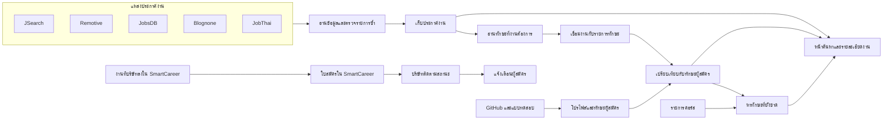
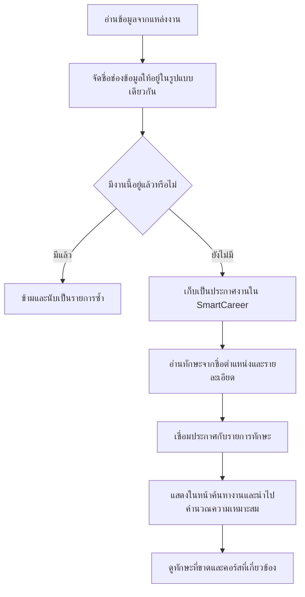

# โครงสร้างและเส้นทางข้อมูลของ SmartCareer

เอกสารนี้เล่าว่าข้อมูลสำคัญของ SmartCareer เก็บอยู่ตรงไหน และเดินทางจากแหล่งข้อมูลไปถึงหน้าที่ผู้ใช้เห็นอย่างไร โดยใช้ภาษาทั่วไป

ลองนึกว่าฐานข้อมูลเป็น **ตู้แฟ้มกลางของระบบ**: มีแฟ้มผู้สมัคร แฟ้มงาน แฟ้มทักษะ และแฟ้มใบสมัคร แต่ละแฟ้มมีรหัสที่ช่วยให้ระบบรู้ว่า “ทักษะนี้เป็นของผู้สมัครคนนี้” หรือ “งานนี้ต้องการทักษะอะไร” เว็บและระบบหลังบ้านอ่านแฟ้มชุดเดียวกันผ่าน API

## มองภาพรวม

## การดึงประกาศงานใช้เครื่องมืออะไร

ระบบมีทั้งการอ่านหน้าเว็บและการขอข้อมูลจาก API ซึ่งเป็นช่องทางที่แหล่งข้อมูลจัดเตรียมไว้ให้โดยตรง

| เครื่องมือหรือวิธี | อธิบายแบบง่าย | ใช้กับ |
|---|---|---|
| **Axios** | ส่งคำขอไปยังเว็บหรือบริการข้อมูล แล้วรับหน้าเว็บหรือข้อมูลกลับมา | ทุกแหล่งที่ระบบเรียกข้อมูล |
| **Cheerio** | ช่วยค้นหาข้อความในหน้าเว็บ เช่น ชื่อตำแหน่ง ชื่อบริษัท และลิงก์ โดยไม่ต้องไล่อ่าน HTML เอง | JobsDB, Blognone และ JobThai |
| **Puppeteer** | เปิดหน้าเว็บด้วยเบราว์เซอร์อัตโนมัติ กรณีบางหน้าต้องให้เว็บทำงานก่อนจึงเห็นประกาศ | ทางเลือกสำรองสำหรับ JobsDB และ Blognone |
| **การเชื่อมต่อ HTTP/2** | อีกวิธีหนึ่งในการขอหน้าเว็บ เมื่อการเชื่อมต่อแบบปกติใช้ไม่ได้ | ทางเลือกสำรองของหน้า JobsDB/Blognone และข้อมูลสาธารณะ Blognone |
| **API ของ JSearch และ Remotive** | รับข้อมูลประกาศในรูปแบบที่จัดเป็นช่องไว้แล้ว จึงไม่ต้องอ่านหน้าเว็บด้วยวิธี scraping | JSearch ผ่าน RapidAPI และ Remotive |

คำว่า **scraping** ในเอกสารนี้หมายถึงการให้ระบบอ่านข้อมูลที่ปรากฏบนหน้าเว็บโดยอัตโนมัติ ส่วน JSearch และ Remotive เป็นการขอข้อมูลผ่าน API จึงไม่ใช่การ scraping หน้าเว็บ

## แต่ละแหล่งให้ข้อมูลอะไรบ้าง

ข้อมูลที่ได้ไม่เหมือนกันทุกเว็บ บางเว็บแสดงเงินเดือนหรือรายละเอียดครบ บางเว็บให้เพียงหัวข้อย่อ ระบบจึงบันทึกเท่าที่แหล่งนั้นส่งมา

| แหล่ง | วิธีรับข้อมูล | ข้อมูลที่ระบบอ่านได้ในรอบปกติ | ข้อจำกัดที่พบในโค้ด |
|---|---|---|---|
| **JSearch** | API ผ่าน RapidAPI | ชื่อตำแหน่ง บริษัท โลโก้ รายละเอียด สถานที่ งานระยะไกล ประเภทงาน เงินเดือนถ้ามี และลิงก์สมัคร/ดูงาน | ประเภทงานบางชนิดถูกรวมเป็นงานเต็มเวลา |
| **Remotive** | API ของ Remotive | ชื่อตำแหน่ง บริษัท โลโก้ รายละเอียด สถานที่หรือพื้นที่ทำงานระยะไกล และลิงก์ต้นทาง | ไม่มีเงินเดือนจากตัวอ่านชุดนี้ และกำหนดประเภทเป็นงานเต็มเวลา |
| **JobsDB** | อ่านหน้าเว็บด้วย Cheerio; อาจใช้เบราว์เซอร์สำรอง | ชื่อตำแหน่ง บริษัท คำอธิบายสั้น สถานที่ ตัวบอกงานระยะไกล ประเภทงานโดยประมาณ และลิงก์ต้นทาง | ตัวอ่านรายการงานไม่ดึงเงินเดือน และอาจได้เพียงข้อความตัวอย่าง |
| **Blognone Jobs** | อ่านหน้าเว็บ; มีข้อมูลสาธารณะเป็นทางเลือกสำรอง | ชื่อตำแหน่ง บริษัท พื้นที่ ประเภทงาน เงินเดือนถ้าแสดงบนหน้า และลิงก์ต้นทาง | ในรอบปกติ คำอธิบายเริ่มจากชื่อตำแหน่ง และอาจไม่มีโลโก้ |
| **JobThai** | อ่านหน้าเว็บด้วย Cheerio | ชื่อตำแหน่ง บริษัท รหัสประกาศ และลิงก์ต้นทาง | รอบปกติตั้งคำอธิบายเป็นชื่อตำแหน่ง สถานที่และเงินเดือนอาจไม่มีข้อมูล และตั้งประเภทงานเริ่มต้นเป็นงานเต็มเวลา |

สำหรับ Blognone และ JobThai มีขั้นตอนเสริมที่สามารถเข้าไปอ่านหน้ารายละเอียดของประกาศเพื่อเติมคำอธิบาย คุณสมบัติ บริษัท โลโก้ หรือสวัสดิการ แล้วตรวจหาทักษะอีกครั้ง ขั้นตอนนี้แยกจากการดึงรายการงานตามปกติ จึงไม่ควรคาดหวังว่าทุกประกาศจะมีรายละเอียดเต็มทันทีหลังนำเข้า

### ฟิลด์ที่ได้จากแต่ละแหล่งโดยละเอียด

ระบบจัดข้อมูลจากแต่ละเว็บให้อยู่ในชุดช่องกลางเดียวกันก่อนบันทึก ชื่อช่องภาษาอังกฤษในวงเล็บคือชื่อที่ใช้ในระบบ บางช่องเป็นค่าว่างหรือค่าเริ่มต้นเมื่อเว็บไม่ได้ให้ข้อมูลนั้น

| แหล่ง | ฟิลด์ที่อ่านได้ |
|---|---|
| **JSearch** | `id`, `title`, `company`, `logoUrl`, `description`, `location`, `isRemote`, `employmentType`, `salaryMin`, `salaryMax`, `salaryCurrency`, `url` |
| **Remotive** | `id`, `title`, `company`, `logoUrl`, `description`, `location`, `isRemote`, `employmentType`, `url`; ไม่มีฟิลด์เงินเดือนในตัวอ่านชุดนี้ |
| **JobsDB** | `id`, `title`, `company`, `description`, `location`, `isRemote`, `employmentType`, `url`; `logoUrl` และฟิลด์เงินเดือนไม่มีข้อมูลจากตัวอ่านชุดนี้ |
| **Blognone Jobs** | `id`, `title`, `company`, `description`, `location`, `isRemote`, `employmentType`, `salaryMin`, `salaryMax`, `url`; `logoUrl` ว่าง และสกุลเงินจะใช้ค่าเริ่มต้น THB ตอนบันทึก |
| **JobThai** | `id`, `title`, `company`, `description`, `location`, `isRemote`, `employmentType`, `url`; `logoUrl` และเงินเดือนว่าง ในรอบปกติใช้คำอธิบายเป็นชื่อตำแหน่ง สถานที่ “ไม่ระบุ” งานระยะไกล “ไม่” และประเภทงานเต็มเวลา |

ความหมายของแต่ละฟิลด์: `id` คือรหัสประกาศจากต้นทาง, `title` ชื่อตำแหน่ง, `company` บริษัท, `logoUrl` ที่อยู่รูปโลโก้, `description` คำอธิบาย, `location` สถานที่, `isRemote` ระบุงานระยะไกลหรือไม่, `employmentType` ประเภทงาน, `salaryMin`/`salaryMax` ช่วงเงินเดือน, `salaryCurrency` สกุลเงิน และ `url` ลิงก์ประกาศเดิม

รายละเอียดเฉพาะที่ควรรู้: Remotive ตัดข้อความ HTML ออกจากคำอธิบายและเก็บไม่เกิน 1,000 ตัวอักษร; JobsDB ใช้ข้อความตัวอย่างจากรายการงาน; Blognone ใช้เขต/จังหวัดและเงินเดือนเฉพาะเมื่อมีการแสดงช่วงเงินเดือน; JobThai สร้างรหัสจากลิงก์ประกาศ

**เมื่อบันทึกลงระบบ** ยังมีข้อมูลที่ระบบสร้างหรือเติมเอง ไม่ได้อ่านมาจากเว็บโดยตรง:

- รหัสงานภายใน SmartCareer (`id`) และ URL สำหรับชื่อหน้า (`slug`) สร้างขึ้นใหม่ ส่วนรหัสจากเว็บเดิมถูกเก็บแยกเป็น `externalId`
- แหล่งที่มา (`source`) และลิงก์กลับไปยังประกาศเดิม (`sourceUrl`) ถูกเก็บไว้เพื่อแสดงชื่อเว็บต้นทางและปุ่มไปสมัคร
- ถ้าไม่มีสถานที่ ระบบใส่ “ไม่ระบุสถานที่”; ถ้าไม่มีสกุลเงิน ระบบตั้งเป็น THB ซึ่ง **ไม่ได้หมายความว่ามีข้อมูลเงินเดือน**
- ถ้าไม่มีคำอธิบาย ระบบใช้ข้อความแจ้งให้ตรวจรายละเอียดที่เว็บต้นทาง; ถ้าไม่มีข้อมูลเงินเดือน ช่องเงินเดือนจะว่าง
- วันเวลาที่เพิ่มประกาศและสถานะเปิดใช้งานถูกกำหนดโดยระบบ

ในรอบดึงปกติ ระบบมักยังไม่มีช่องคุณสมบัติผู้สมัคร (`requirements`) และสวัสดิการ (`benefits`) แยกจากคำอธิบาย ขั้นตอนเสริมสำหรับรายละเอียดเต็มของ Blognone/JobThai อาจอ่านข้อมูลเหล่านี้จากหน้ารายละเอียดแล้วเติมลงในประกาศได้ ทั้งนี้ไม่ได้ทำครบทุกงานในรอบปกติ

**ทักษะที่ระบบตรวจพบไม่ใช่ฟิลด์ที่เว็บส่งมาแยกต่างหาก** ระบบอ่านจากชื่อตำแหน่งและข้อความรายละเอียด แล้วเพิ่มความเชื่อมโยงระหว่างงานกับรายการทักษะในภายหลัง หากมีการเปิดใช้ Gemini ระบบใช้ AI ช่วยอ่าน; หากไม่พร้อมใช้จะค้นจากคำสำคัญแทน

## หลังจากอ่านประกาศแล้ว ระบบทำอะไรต่อ

1. **จัดข้อมูลให้อยู่ในรูปแบบเดียวกัน** เช่น ใช้ช่องชื่อบริษัท ชื่อตำแหน่ง สถานที่ เงินเดือน และลิงก์ แม้แต่ละเว็บจะจัดข้อมูลมาไม่เหมือนกัน
2. **ตรวจงานซ้ำ** โดยเทียบรหัสงานจากแหล่งเดิม หรือเทียบชื่อตำแหน่งกับชื่อบริษัท ถ้ามีรายการที่ตรงอยู่แล้ว ระบบจะนับเป็นงานซ้ำและข้าม ไม่สร้างแถวเดิมซ้ำ
3. **เก็บประกาศงาน** ในแฟ้มงาน (`jobs`) พร้อมบันทึกว่าได้มาจากที่ใดและลิงก์กลับไปยังประกาศต้นฉบับ งานจากเว็บภายนอกจะเก็บชื่อบริษัทไว้กับประกาศงาน ไม่ได้สร้างบัญชีบริษัทใน SmartCareer ให้อัตโนมัติ
4. **อ่านทักษะที่งานต้องการ** ระบบใช้ Gemini เมื่อมีการตั้งค่าให้ใช้ AI หากใช้ AI ไม่ได้จะลองค้นจากคำสำคัญที่รู้จัก เช่น React, Python หรือ PostgreSQL
5. **เชื่อมงานกับทักษะ** รายการทักษะเก็บในแฟ้มทักษะกลาง (`skills`) และความต้องการของแต่ละงานเก็บแยกในแฟ้มเชื่อมงานกับทักษะ (`job_skills`) โดยระบุว่าเป็นทักษะจำเป็นหรือทักษะเสริม
6. **บันทึกผลการนำเข้า** เช่น เพิ่มกี่งาน ซ้ำกี่งาน หรือมีข้อผิดพลาดกี่รายการ ไว้ในประวัติการทำงานของระบบ เพื่อให้ผู้ดูแลตรวจสอบได้

ผลการอ่านทักษะขึ้นอยู่กับข้อความที่ต้นทางให้มา ถ้าประกาศมีเพียงชื่อหรือคำอธิบายสั้น ระบบก็อาจพบรายการทักษะได้น้อยกว่าประกาศที่มีรายละเอียดครบ

## ประกาศงานไปเชื่อมกับส่วนไหนบ้าง

### ค้นหาและดูรายละเอียดงาน

หน้าค้นหางานอ่านประกาศที่ยังเปิดใช้งาน ผู้ใช้ค้นหาตามคำ ตำแหน่ง สถานที่ แหล่งประกาศ หรือรูปแบบทำงานระยะไกลได้ หน้าแรกยังหยิบงานบางส่วนมาแสดงด้วย

### เปรียบเทียบงานกับผู้สมัคร

ระบบนำทักษะที่งานต้องการ (`job_skills`) ไปเทียบกับทักษะของผู้สมัคร (`candidate_skills`) และเป้าหมายอาชีพในโปรไฟล์ เพื่อแสดงคะแนนความเหมาะสมโดยประมาณ โดยแบ่งน้ำหนักเป็นทักษะจำเป็น 70% ทักษะเสริม 20% และเป้าหมายอาชีพ 10%

ข้อมูลทักษะของผู้สมัครมาจากคนละทางกับการดึงประกาศงาน เช่น การอ่านข้อมูล GitHub และผลแบบทดสอบ การนำเข้างาน **ไม่ได้แก้คะแนนทักษะของผู้สมัคร** แต่เพิ่มข้อมูลว่าประกาศงานนั้นต้องการทักษะใด

### แนะนำคอร์สจากทักษะที่ยังขาด

ถ้าผู้สมัครดูรายละเอียดงาน ระบบจะแสดงทักษะที่ยังขาดและค้นหาคอร์สที่เกี่ยวข้อง คอร์สอยู่ในแฟ้มคอร์ส (`courses`) และเชื่อมกับทักษะผ่านแฟ้มเชื่อมคอร์สกับทักษะ (`course_skills`)

ข้อมูลคอร์สมีวิธีรับต่างจากงาน: YouTube เริ่มจากรายการวิดีโอที่ระบบเตรียมไว้ แล้วตรวจชื่อ ช่อง และข้อมูลวิดีโอที่ YouTube เปิดให้ตรวจสอบ ส่วน Udemy ใช้ API ทางการเมื่อมีข้อมูลเชื่อมต่อ ถ้าไม่มีจะใช้รายการคอร์สที่ระบบเตรียมไว้ จึงไม่ใช่การกวาดค้นหาคอร์สทั้งหมดบนเว็บ

## การสมัครงานเชื่อมอย่างไร

- **ประกาศที่มีลิงก์ไปยังเว็บไซต์ต้นทาง**: ปุ่มสมัครจะพาผู้ใช้ไปสมัครบนเว็บต้นทาง การกดปุ่มนี้ไม่ได้สร้างใบสมัครหรือบันทึกสถานะการสมัครไว้ใน SmartCareer
- **งานที่สมัครผ่าน SmartCareer**: ระบบสร้างใบสมัครในแฟ้มใบสมัคร (`job_applications`) เก็บประวัติเปลี่ยนสถานะแยกไว้ (`application_status_histories`) และบริษัทใช้ติดตามผู้สมัครต่อได้
- เมื่อบริษัทเปลี่ยนสถานะ ระบบมีข้อมูลสำหรับส่งการแจ้งเตือนให้ผู้สมัคร ส่วนการประเมินผู้สมัครโดยบริษัทเก็บแยกจากคะแนนทักษะของผู้สมัคร และไม่ได้ปรับคะแนนทักษะอัตโนมัติ

## ข้อมูลกลุ่มอื่นในระบบ

| สิ่งที่ผู้ใช้เห็น | ตัวอย่างข้อมูลที่เก็บ | เชื่อมกับ |
|---|---|---|
| บัญชีและโปรไฟล์ผู้สมัคร | ชื่อ ประวัติ เป้าหมายอาชีพ และบัญชีที่เชื่อม | คะแนนทักษะ การสมัครงาน และการทำแบบทดสอบ |
| หลักฐานทักษะ | Repository จาก GitHub และผลแบบทดสอบ | ทักษะของผู้สมัครแต่ละคน |
| บริษัท | ข้อมูลบริษัท สมาชิก และเอกสารตรวจสอบ | งานที่บริษัทลงและผู้สมัครในกระบวนการรับสมัคร |
| แบบทดสอบ | ชุดคำถาม ตัวเลือก คำตอบ คะแนน และผลตรวจ | ผู้สมัคร ทักษะ หรือใบสมัครที่บริษัทมอบหมายแบบทดสอบให้ |
| คอร์สเรียน | ชื่อคอร์ส ผู้ให้บริการ ลิงก์ รูปภาพ และระยะเวลา | ทักษะที่คอร์สช่วยฝึก |
| ประวัติระบบ | รอบนำเข้า จำนวนงานใหม่/ซ้ำ และข้อผิดพลาด | หน้าผู้ดูแลระบบใช้ตรวจสอบการทำงาน |

## การดึงข้อมูลและตรวจงานที่ปิดรับ

ระบบตั้งให้ดึงรายการงานจาก JSearch, JobsDB, Blognone, JobThai และ Remotive ทุกวันเวลาเที่ยงคืนตามเวลาไทย และดึงข้อมูลคอร์สจาก YouTube/Udemy ในรอบเวลาเดียวกัน ผู้ดูแลยังสั่งดึงจากหน้าระบบหลังบ้านได้ด้วย หลังจากนั้นมีงานตรวจประกาศที่อาจปิดหรือหมดอายุทุกวันเวลา 00:30 น. งานที่ปิดจะถูกซ่อนจากรายการงาน แต่ยังเก็บข้อมูลและประวัติที่เกี่ยวข้องไว้

## ชื่อแฟ้มข้อมูลที่อาจพบในโค้ด

ถ้าต้องการค้นหาชื่อจริงของข้อมูลในโครงการ สามารถเริ่มจากรายการนี้ได้

| ความหมาย | ชื่อในระบบ |
|---|---|
| ประกาศงาน | `jobs` |
| ทักษะที่งานต้องการ | `job_skills` |
| รายการทักษะกลาง | `skills` |
| โปรไฟล์ผู้สมัคร | `candidate_profiles` |
| คะแนนทักษะผู้สมัคร | `candidate_skills` |
| ใบสมัครและประวัติสถานะ | `job_applications`, `application_status_histories` |
| คอร์สและทักษะที่เกี่ยวข้อง | `courses`, `course_skills` |
| ประวัติการดึงข้อมูล | `ingestion_runs`, `ingestion_logs` |

## ไฟล์ต้นทางสำหรับผู้ที่ต้องการตรวจสอบรายละเอียด

- วิธีดึงและบันทึกงาน/คอร์ส: [`ingestion.service.ts`](../apps/api/src/ingestion/ingestion.service.ts)
- การอ่านข้อมูลลึกและค้นหาทักษะ: [`gemini-extractor.service.ts`](../apps/api/src/ingestion/gemini-extractor.service.ts)
- การตั้งเวลาดึงและตรวจข้อมูล: [`scheduler.service.ts`](../apps/api/src/scheduler/scheduler.service.ts)
- วิธีแสดงและค้นหางาน: [`jobs.service.ts`](../apps/api/src/jobs/jobs.service.ts)
- วิธีเปรียบเทียบทักษะกับงาน: [`matching.service.ts`](../apps/api/src/matching/matching.service.ts)
- ความสัมพันธ์ของข้อมูลทั้งหมด: [`schema.prisma`](../prisma/schema.prisma)

## การแยกบริบท GitHub และผลประเมิน (27 ตุลาคม 2569)

- `GitHubRepository.languagesBreakdown` เก็บจำนวน bytes ต่อภาษา สัดส่วนใช้ภายใน repository เท่านั้น
- `GitHubEvidence.scoreContribution` และ `CandidateSkill.practicalScore/verifiedScore` เป็นคอลัมน์เก่า ไม่ใช้คำนวณความชำนาญ matching หรือช่องว่าง ข้อมูลเก่าไม่ถูกลบ การ sync ใหม่เขียน contribution=0 และไม่แก้ cache คะแนน
- `Assessment.skillId` เป็นทักษะของข้อสอบ ส่วน `AssessmentAttempt.snapshot` เก็บ skillAssessmentVersion=1, skill (id/name/category), assessmentType/version, passingScore, criteriaHash, รายการ question points/evaluationMethod/testCaseCount/rubric ณ วันเริ่มสอบ ไม่มีเฉลยหรือ test input ซ่อนใน snapshot ใหม่
- ผลมีสถานะ ASSESSED/GAP ตามเกณฑ์ที่กำลังเทียบ; ไม่มีผลที่เข้าเงื่อนไขเป็น NOT_ASSESSED พร้อมคะแนน null ไม่ใช่แถวคะแนน 0 ที่ระบบสร้างขึ้น
- `JobApplication.matchScoreAtApplication` เป็น nullable และเพิ่ม `matchAssessmentSnapshot Json?` ด้วย migration ที่ไม่ลบข้อมูลเดิม เก็บ policyVersion, scoreSource, coverage, status และ attemptId ของทักษะที่ประเมิน ใบสมัครเก่ามี snapshot=null และตัวเลขเดิมยังคงอยู่เพื่อ audit

รายละเอียด API และ migration: [ASSESSMENT_POLICY_IMPLEMENTATION.md](ASSESSMENT_POLICY_IMPLEMENTATION.md)
