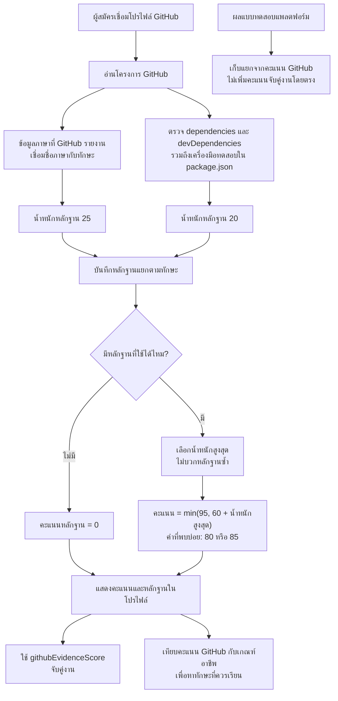
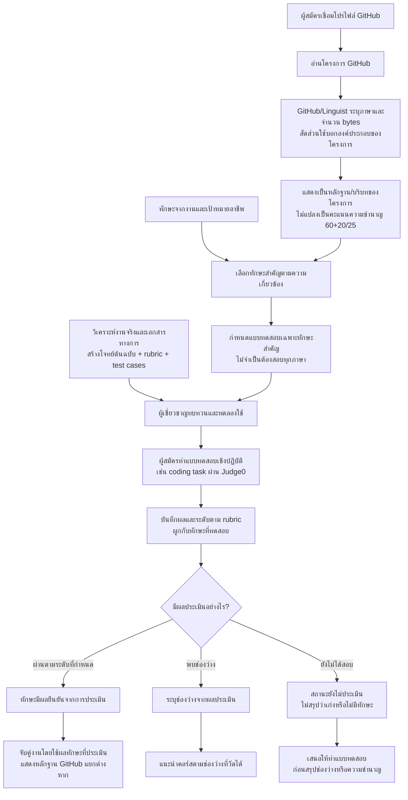

# เปรียบเทียบหัวข้อ 3: หลักฐานทักษะจาก GitHub

เอกสารนี้เปรียบเทียบกระบวนการในหัวข้อ 3 ของ `README.md` ปัจจุบันกับแนวทางที่เสนอให้ใช้ GitHub/Linguist เป็นข้อมูลหลักฐานจากโครงการ และใช้แบบทดสอบเชิงปฏิบัติยืนยันระดับทักษะที่สำคัญ

> อัปเดต 27 ตุลาคม 2569: นำหลักการส่วนที่ 2 ไปใช้ในโค้ดแล้ว รายละเอียดและข้อจำกัดปัจจุบันดู [รายงานการปรับระบบ](ASSESSMENT_POLICY_IMPLEMENTATION.md) ส่วนที่ 1 และคอลัมน์ “ปัจจุบัน” ด้านล่างเป็นบันทึกพฤติกรรมก่อนเปลี่ยน ไม่ใช่สูตรที่ยังใช้งานอยู่

## 1. กระบวนการเดิมก่อนปรับระบบ

ปัจจุบันระบบตรวจพบภาษาและเครื่องมือจากโครงการ GitHub แล้วแปลงเป็นน้ำหนักหลักฐาน จากนั้นใช้คะแนนฐาน 60 และน้ำหนักสูงสุด 20 หรือ 25 คิด `githubEvidenceScore` คะแนนนี้ถูกใช้ต่อในการจับคู่งานและคำแนะนำตามเป้าหมายอาชีพ แม้ README จะระบุว่าคะแนนนี้ไม่ใช่ผลวัดความชำนาญโดยตรง

## 2. แนวทางที่เสนอ

แยกคำถามสองข้อออกจากกัน: GitHub บอกว่า **พบภาษา/เครื่องมืออะไรในโครงการ** ส่วนแบบทดสอบเชิงปฏิบัติบอกว่า **ผู้สมัครทำทักษะนั้นได้ระดับใด** ไม่ใช้การมีภาษาเพียงเล็กน้อยใน repository เพื่อสรุปว่าชำนาญ และไม่ถือว่าการไม่มีหลักฐานจาก GitHub แปลว่าไม่มีทักษะ

### หลักการของแนวทางที่เสนอ

- **Linguist เป็นหลักฐานบริบทของ repository:** ภาษาและสัดส่วนช่วยอธิบายองค์ประกอบของโครงการ ไม่ยืนยันว่าใครเป็นผู้เขียนโค้ดทั้งหมดหรือชำนาญภาษานั้น
- **แบบทดสอบเจาะเฉพาะทักษะสำคัญ:** จัดลำดับจากทักษะที่ประกาศงานและเป้าหมายอาชีพต้องการ ไม่จำเป็นต้องสร้างข้อสอบให้ทุกภาษา
- **ไม่มีผลสอบหมายถึงยังไม่ทราบ:** แสดงสถานะ “ยังไม่ประเมิน” แทนการให้คะแนนความชำนาญจากการพบภาษาใน GitHub หรือการตีความว่าไม่มีทักษะ
- **คุณภาพข้อสอบต้องมีหลักฐานรองรับ:** Agent ช่วยวิเคราะห์ประกาศงานและเอกสารทางการ สร้างโจทย์ต้นฉบับ rubric และ test cases ได้ แต่ก่อนใช้ตัดสินผู้สมัครจริงควรให้ผู้เชี่ยวชาญตรวจและทดลองกับกลุ่มเล็กก่อน

## 3. ความแตกต่างและผลกระทบที่ต้องพิจารณา

| ประเด็น | ปัจจุบัน | แนวทางที่เสนอ |
|---|---|---|
| ความหมายของข้อมูล GitHub | แปลงหลักฐานเป็น `githubEvidenceScore` | ใช้บอกภาษา/เครื่องมือที่พบและองค์ประกอบของโครงการ |
| คะแนน 60 และน้ำหนัก 20/25 | เป็นค่าที่ผู้พัฒนากำหนดและส่งผลต่อคะแนน | ไม่ใช้ตัวเลขเหล่านี้แทนความชำนาญ |
| การยืนยันความชำนาญ | อาศัยหลักฐานทางอ้อมจาก repository | ใช้ผลแบบทดสอบที่ผูกกับทักษะและ rubric |
| ทักษะที่มีหลักฐานเพียงเล็กน้อย | อาจได้คะแนนหลักฐานแล้วนำไปใช้ต่อ | ยังเป็นเพียงเบาะแส ไม่ถือว่าผ่านการยืนยัน |
| ทักษะที่ยังไม่มีผลสอบ | GitHub ไม่มีหลักฐานอาจได้ 0 | ระบุ “ยังไม่ประเมิน” และเสนอการทดสอบเมื่อทักษะนั้นสำคัญ |
| การจับคู่งาน | ปัจจุบันใช้คะแนน GitHub เป็นคะแนนทักษะ | ต้องกำหนดวิธีใช้ผลสอบและวิธีแสดงสถานะที่ยังไม่ประเมิน |
| คำแนะนำคอร์ส | เปรียบเทียบคะแนน GitHub กับเกณฑ์อาชีพ | ใช้ช่องว่างที่พบจากผลประเมิน; ผู้ที่ยังไม่ประเมินควรได้รับคำเชิญให้ทดสอบ |

## 4. ส่วนของระบบที่อาจต้องปรับตามแนวทางนี้

การเปลี่ยนเฉพาะแผนภาพในหัวข้อ 3 ยังไม่ทำให้ระบบใช้ผลสอบจริง จำเป็นต้องพิจารณาส่วนที่เชื่อมต่อกันด้วย:

1. **หัวข้อ 3 — โปรไฟล์/GitHub:** เปลี่ยนคำอธิบายและการแสดงผลให้แยก “หลักฐานจากโครงการ” ออกจาก “ระดับทักษะที่ประเมิน”
2. **หัวข้อ 5 — แบบทดสอบ:** ตรวจว่าผลสอบเชิงปฏิบัติผูกกับทักษะและเก็บระดับผลตาม rubric ได้ครบหรือไม่
3. **หัวข้อ 6 — จับคู่งาน:** ปรับแหล่งคะแนนทักษะให้ใช้ผลประเมิน และออกแบบการแสดงทักษะที่ยังไม่มีผลโดยไม่เดาคะแนน
4. **หัวข้อ 8 — คำแนะนำคอร์ส:** ใช้ผลประเมินที่ชี้ช่องว่าง แทนการตีความคะแนน GitHub เป็นระดับความชำนาญ
5. **โปรไฟล์และข้อมูล:** ตรวจ API, หน้าจอ และแบบจำลองข้อมูลว่ารองรับการแสดงหลักฐาน GitHub ผลสอบ และสถานะยังไม่ประเมินแยกจากกันหรือไม่

ผลกระทบหลักจึงไม่ใช่แค่เปลี่ยนสูตร 60/20/25 แต่เป็นการเปลี่ยน **แหล่งข้อมูลที่ระบบใช้ยืนยันระดับทักษะ** และจุดที่ใช้คะแนนนั้นในโปรไฟล์ การจับคู่งาน และคำแนะนำคอร์ส

## แหล่งอ้างอิงภายในโครงการ

- [README.md — หัวข้อ 3, 5, 6 และ 8](../README.md)
- [ตัวตรวจหลักฐาน GitHub](../apps/api/src/github/github.service.ts)
- [สูตรคะแนนหลักฐานและผลคัดกรอง](../packages/shared/src/candidate-screening.ts)
- [การจับคู่งาน](../apps/api/src/matching/matching.service.ts)
- [คำแนะนำคอร์ส](../apps/api/src/recommendations/recommendations.service.ts)
- [การจัดการแบบทดสอบ](../apps/api/src/assessments/assessments.service.ts)
